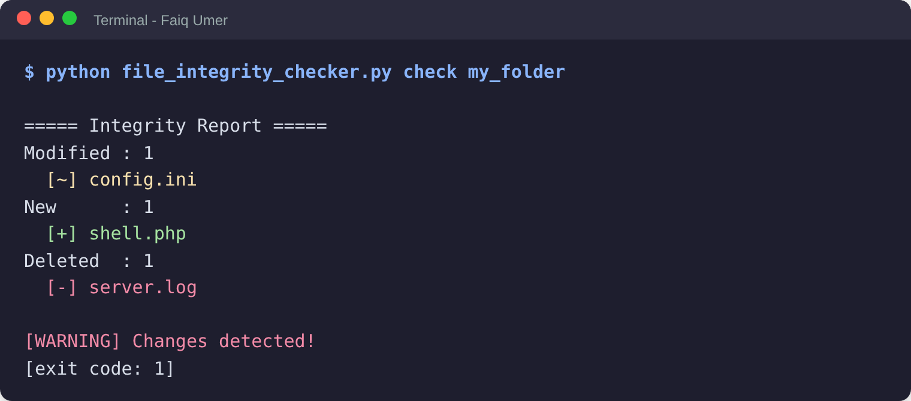

# File Integrity Checker

A lightweight **File Integrity Monitoring (FIM)** tool written in Python. It records a SHA-256 hash of every file in a folder (the *baseline*) and later reports which files were **modified**, **added** or **deleted**.

**Author:** Faiq Umer (ZYNVEX-CERT-2217) · Cyber Security Project, Batch-05

## Why it matters
Attackers who compromise a system often alter configuration files, drop web shells or delete logs to hide their tracks. File integrity monitoring detects these changes. It is a recognised control in standards such as PCI DSS (Req. 11.5.2) and NIST SP 800-53 (SI-7).

## Features
- SHA-256 hashing, read in chunks (works on large files with low memory)
- Recursive scan of sub-folders
- Detects modified, new and deleted files
- Baseline stored as readable JSON
- Baseline may live inside the monitored folder (it is ignored automatically)
- Exit codes for scripting: `0` OK, `1` changes found, `2` error
- Pure Python standard library, nothing to install
- Unit tests included

## Requirements
Python 3.8+ (uses only `hashlib`, `json`, `os`, `argparse`, `sys`).

## Setup
```bash
git clone https://github.com/FaiqUmer/file-integrity-checker.git
cd file-integrity-checker
python file_integrity_checker.py --help
```

## Usage
```bash
# 1. Create a baseline of a trusted folder
python file_integrity_checker.py init my_folder

# 2. Later, check the folder against the baseline
python file_integrity_checker.py check my_folder

# Optional: choose where the baseline is stored
python file_integrity_checker.py init  my_folder --baseline /safe/place/base.json
python file_integrity_checker.py check my_folder --baseline /safe/place/base.json
```

Example output after tampering with the folder:



More screenshots are in the [`screenshots/`](screenshots) folder.

## How it works
1. `init` walks the folder, hashes each file with SHA-256 and saves `{relative_path: hash}` to `baseline.json`.
2. `check` hashes the folder again and compares it with the saved baseline.
3. Different hash = **modified**; path only in new scan = **new**; path only in baseline = **deleted**.

## Tests
```bash
python -m unittest discover -v tests
```
7 tests cover hashing, sub-folders, unchanged folders, all three change types, missing baseline, missing folder and baseline-inside-folder.

## Limitations
- If an attacker can edit `baseline.json` they can hide changes. Store the baseline on read-only or separate media.
- Detects *content* changes only (not permissions or timestamps).
- Checks on demand; it is not a real-time monitor.

## Future improvements
Real-time watching, baseline signing (HMAC), permission/owner tracking, email alerts, exclude patterns, a GUI.

## License
MIT
